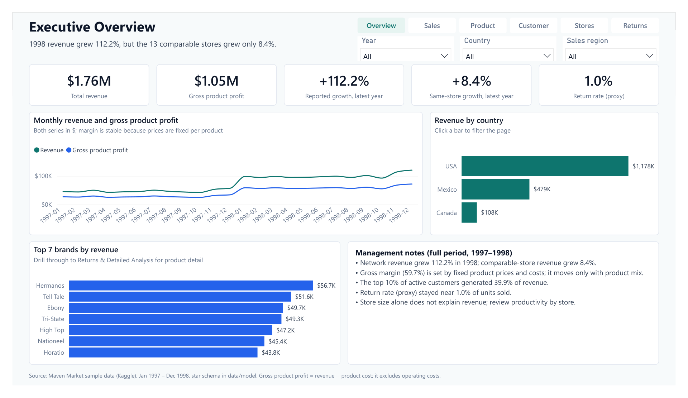

# Maven Market Retail Intelligence

**Reported revenue grew +112.2% in 1998, but only +8.4% in the 13 stores open in both years. More than 90% of the growth came from opening 11 new stores.**

An end-to-end retail analytics project. It covers data audit, cleaning, a star-schema model, exploratory analysis, KPI design and a six-page Power BI report for Maven Market, a grocery chain with 24 stores in the USA, Mexico and Canada (1997–1998).

[](dashboard/dashboard.pdf)

Other pages: [Sales Performance](images/dashboard/02_sales_performance.png) · [Product & Profitability](images/dashboard/03_product_profitability.png) · [Customer Analysis](images/dashboard/04_customer_analysis.png) · [Store & Geographic Performance](images/dashboard/05_store_geography.png) · [Returns & Detailed Analysis](images/dashboard/06_returns_detail.png) · **[Full report (PDF)](dashboard/dashboard.pdf)**

## Progress

- [x] Business scenario and project scope
- [x] Business questions
- [x] Data audit
- [x] Data cleaning
- [x] Data modeling
- [x] Exploratory data analysis
- [x] KPI design
- [x] Power BI dashboard
- [x] Final insights and recommendations

## Key findings

| # | Finding | Numbers |
|---|---|---|
| 1 | Growth came from new stores | Reported revenue +112.2% ($565,238 → $1,199,308); same-store +8.4%. New stores supplied 92.5% of the increase. |
| 2 | The stable margin is structural | Gross margin was 59.64% in 1997 and 59.68% in 1998. Each product has one fixed price and cost, so margin moves only with product mix. |
| 3 | Revenue is concentrated but broad | The top 10% of 8,842 active customers generate 39.9% of revenue, and the top 20% generate 58.1%. The repeat rate is 86.1%. |
| 4 | Golden members spend most per head | Golden $219.72 vs Silver $178.35 per customer. Bronze is 55.9% of revenue. |
| 5 | Store size does not predict revenue | Correlation of floor area with 1998 revenue is −0.10. Revenue per sq ft ranges from $0.20 to $6.15. |
| 6 | Returns are low overall | Return rate (proxy) is 0.99% (8,289 of 833,489 units). The highest store is Store 8 at 1.17%; four stores have no returns recorded. |

Implications and recommendations: [docs/09_insights_and_recommendations.md](docs/09_insights_and_recommendations.md).

## Data and data model

The source is the Maven Market sample dataset (Kaggle). It has eight CSV files: 269,720 transaction rows, 7,087 return rows, 10,281 customers, 1,560 products and 24 stores, from 1 January 1997 to 31 December 1998.

The analysis uses a star schema with two facts and four dimensions:

```text
DimDate       ─┬─> FactSales   (transaction date active, stock date inactive)
               └─> FactReturns
DimCustomer   ───> FactSales
DimProduct    ─┬─> FactSales
               └─> FactReturns
DimStore      ─┬─> FactSales   (store attributes include region)
               └─> FactReturns
```

| Table | Rows |
|---|---:|
| `dim_date` | 737 |
| `dim_customer` | 10,281 |
| `dim_product` | 1,560 |
| `dim_store` | 24 |
| `fact_sales` | 269,720 |
| `fact_returns` | 7,087 |

The model reconciles to **$1,764,546.44 revenue**, **$711,727.66 product cost** and **$1,052,818.78 gross product profit**. Sales and returns stay separate facts, because returns cannot be linked to a customer or a sales line.

## Method

1. **Audit** the raw files without changing them: profiling, referential integrity and business rules.
2. **Clean** with documented rules: keep all source rows, flag duplicate candidates, apply explicit types.
3. **Model** a validated star schema for Power BI.
4. **Explore** the business questions and test which comparisons are valid (reported vs same-store growth).
5. **Design KPIs** with clear denominators: 63 DAX measures in `dax/`.
6. **Build the report** as a Power BI project (`.pbip`, TMDL + PBIR) generated from the design.
7. **Validate** every measure on the Power BI Desktop engine against the KPI snapshot and independent pandas calculations (124 of 124 checks passed).

Definitions:

- **Revenue** = quantity × retail price
- **Gross product profit** = revenue − quantity × product cost
- **Gross margin** = gross product profit ÷ revenue
- **Same-store growth** uses only the 13 stores with sales in both years.
- **Return rate (proxy)** = returned units ÷ units sold.

## Data quality

The audit found no orphan keys and no failed business rules: quantities, prices above cost, store areas and date order all passed. Points carried into the analysis:

- **3 high-severity findings:** there is no transaction ID and no return ID, and store coverage changes from 13 stores (1997) to 24 (1998).
- **Duplicate-looking rows:** 9 transaction rows and 5 return rows repeat every field. They are flagged, not removed, because no source ID can confirm them.
- **Encoding fixes:** blank product flags mean false (687 recyclable, 1,008 low-fat blanks). 20 four-digit postal codes were restored to text. One customer has no surname.
- **Calendar gaps:** 57 calendar dates have no sales rows (42 in 1997, 15 in 1998).

Details: [reports/data_quality_report.md](reports/data_quality_report.md) and [reports/data_cleaning_report.md](reports/data_cleaning_report.md).

## Limitations

- **No order ID.** Rows are product lines, so order count, basket size and average order value cannot be calculated.
- **Return rate is a proxy.** Returns cannot be matched to the original sale or customer; the rate is directional.
- **Fixed price list.** One price and one cost per product means margin analysis measures product mix only. There is no discount or cost-change data.
- **Only two years.** That is not enough for robust seasonality or forecasting, and 11 stores have only one year of sales.
- Gross product profit excludes operating costs and is not net profit.

## How to open the dashboard

1. **Read the PDF first:** [dashboard/dashboard.pdf](dashboard/dashboard.pdf), or the page images above. No software is needed.
2. **Open it in Power BI Desktop:**
   - Build or unzip the data so that `data/model/*.csv` exists (see below).
   - Open `dashboard/MavenMarket.pbip`.
   - Go to **Transform data → Edit parameters** and set **DataFolder** to the full path of your `data/model` folder.
   - Click **Refresh**.
3. **If the refresh crashes or runs out of memory,** go to **File → Options and settings → Options → Global → Data Load**. Set **Maximum number of simultaneous evaluations** to **1**, then refresh again.

## How to reproduce

Requirements: Python 3.12+ and Power BI Desktop (only for the report). Download the eight Kaggle CSV files into `data/raw/`; the expected names are in [data/raw/README.md](data/raw/README.md).

```powershell
python -m venv .venv
.venv\Scripts\activate
pip install -r requirements.txt

python scripts/data_audit.py                # reports/data_quality_report.md
python scripts/data_cleaning.py             # data/processed/
python scripts/build_star_schema.py         # data/model/
python scripts/exploratory_data_analysis.py # reports/eda_summary.md, images/eda/
python scripts/calculate_kpis.py            # reports/kpi_baseline_snapshot.csv
python scripts/build_power_bi_report.py     # dashboard/MavenMarket.pbip

python -m pytest                            # 170+ tests: pipeline, model, layout
```

The data files are not stored in git. If you received the project zip, `data/model/` is already included and you can open the dashboard directly.

Optional steps with the report open in Power BI Desktop:

```powershell
python scripts/validate_power_bi_measures.py --refresh   # all measures on the Desktop engine
python scripts/export_dashboard_images.py                # after File > Export > Export to PDF
```

## Project structure

```text
maven-market-retail-intelligence/
├── dashboard/
│   ├── MavenMarket.pbip            # Power BI project (open this)
│   ├── MavenMarket.SemanticModel/  # TMDL model
│   ├── MavenMarket.Report/         # PBIR report, 6 pages
│   ├── dashboard.pdf               # exported report
│   ├── wireframes/                 # design wireframes
│   └── maven_market_power_bi_theme.json
├── data/                           # raw, processed and model CSVs (rebuilt by scripts)
├── dax/                            # KPI and dashboard measures
├── docs/                           # stage documents 01–09
├── images/
│   ├── dashboard/                  # report page images
│   └── eda/                        # analysis charts
├── notebooks/                      # stage notebooks 03–07
├── reports/                        # audit, cleaning, model, EDA, KPI and validation outputs
├── scripts/                        # reproducible pipeline and report build
├── sql/                            # star-schema DDL
├── tests/                          # pytest suite and vendored PBIR schemas
└── requirements.txt
```

## Tech stack

- **Python:** pandas, NumPy, Matplotlib, Jupyter, pytest, jsonschema, PyMuPDF
- **Power BI Desktop:** a `.pbip` project with a TMDL semantic model, a PBIR report, DAX measures and Power Query (M)
- **Validation:** Tabular Object Model and ADOMD.NET (Power BI Desktop's local engine), and Microsoft's PBIR JSON schemas
- **SQL:** star-schema DDL

## Documentation

1. [Project definition](docs/01_project_definition.md)
2. [Business questions](docs/02_business_questions.md)
3. [Data audit](docs/03_data_audit.md)
4. [Data cleaning](docs/04_data_cleaning.md)
5. [Data modeling](docs/05_data_modeling.md)
6. [Exploratory data analysis](docs/06_exploratory_data_analysis.md)
7. [KPI design](docs/07_kpi_design.md)
8. [Power BI dashboard](docs/08_power_bi_dashboard.md)
9. [Insights and recommendations](docs/09_insights_and_recommendations.md)

## Author

**Atefeh Kalamati** · [github.com/atefekalamati](https://github.com/atefekalamati)
